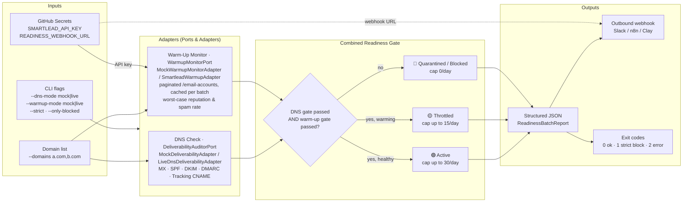
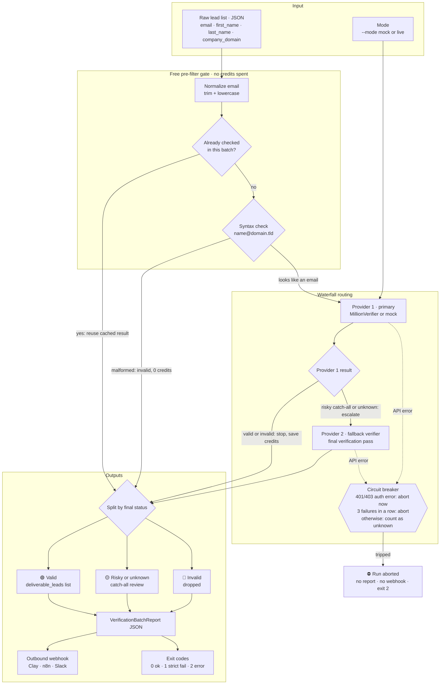
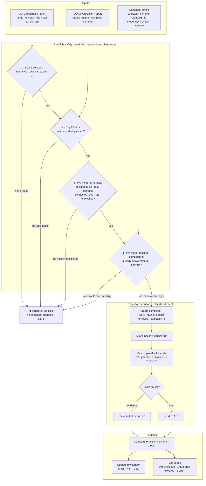
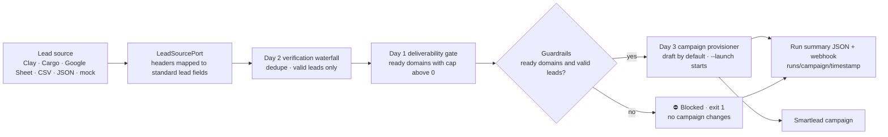

# GTM Systems Engine

Pre-flight readiness gate for cold-email sending domains. For every domain it checks **DNS authentication** and **mailbox warm-up health**, then decides whether the domain may send today and at what daily cap.



## How it decides

| Area | Rule | Result |
|---|---|---|
| **DNS: MX** | At least one MX record | Missing → `missing_mx` |
| **DNS: SPF** | Exactly one `v=spf1` record with a qualifier or `include:` | Missing, duplicated or invalid → `invalid_or_missing_spf` |
| **DNS: DKIM** | `<selector>._domainkey.<domain>` has a key (TXT) or CNAME | Missing → `missing_dkim_selector:<selector>` |
| **DNS: DMARC** | `_dmarc.<domain>` has a policy (`none`, `quarantine` or `reject`) | Missing → `missing_dmarc` |
| **DNS: Tracking** | Tracking host resolves (CNAME or A) | Missing → `invalid_tracking_cname:<host>` |
| **Warm-up: quarantine** | No accounts, SMTP disconnected, warm-up blocked, status ≠ `ACTIVE`, lowest reputation < 70 (Smartlead) / < 65 (mock), or worst spam/bounce rate > 3% | 🔴 cap **0**, gate fails |
| **Warm-up: throttle** | Lowest reputation < 85 or worst spam/bounce rate > 1.5% | 🟡 cap **min(daily limit, 15)**, gate passes |
| **Warm-up: active** | Everything healthy | 🟢 cap **min(daily limit, 30)**, gate passes |
| **Readiness** | Ready only if **both** gates pass; a blocked domain's cap is 0 | Reasons prefixed `dns:` / `warmup:` |

A domain's warm-up health is judged by its **weakest mailbox**: the lowest reputation and the highest spam rate across all its Smartlead accounts. Its daily limit is the sum of their `max_email_per_day`.

## Run it

| Where | How |
|---|---|
| **Install** | `pip install -e ".[dev]"` (Python 3.11+) |
| **Tests** | `pytest -v` |
| **Local, sample data** | `python -m gtm_engine.cli.check_readiness --domains healthy-outreach.com,throttled-sender.com,quarantined-sender.com` |
| **Local, live data** | `SMARTLEAD_API_KEY=… python -m gtm_engine.cli.check_readiness --domains yourdomain.com --dns-mode live --warmup-mode live --selector <dkim-selector> --tracking-host <subdomain> --strict` |
| **Send to a webhook** | Add `--webhook-url <url>` (or set `READINESS_WEBHOOK_URL`); add `--only-blocked` to post only when something is blocked |
| **GitHub Actions: CI** | Every push to `main` / `feat/**` and every PR runs `pytest` |
| **GitHub Actions: daily** | Runs the readiness check at 20:00 UTC (mock data by default) |
| **GitHub Actions: on demand** | Actions → *GTM Readiness CI & Runner* → *Run workflow*, then choose domains, `dns_mode`, `warmup_mode`, selector and tracking host |
| **Secrets** | Settings → Secrets and variables → Actions: `SMARTLEAD_API_KEY`, `READINESS_WEBHOOK_URL` |

**Exit codes:** `0` the run completed · `1` `--strict` and at least one domain is blocked · `2` an error (Smartlead API or webhook failure; the key is never printed).

## Day 2: Cost-optimized lead verification waterfall

Verifies lead emails before they enter a sequence. Free checks run first, clear answers stop at the first provider, and only unsure results pay for a second opinion.



| Area | Rule |
|---|---|
| **Syntax check** | Not shaped like `name@domain.tld` → `invalid` with `attempts: 0`; no provider is called |
| **Stop rule** | `valid` or `invalid` from any provider ends the waterfall |
| **Fallback rule** | `risky` or `unknown` escalates to the next provider; a provider error counts as `unknown` |
| **Tie-break** | A later `unknown` never overrides an earlier `risky` |
| **MillionVerifier mapping** | `ok` → valid · `catch_all`, `unknown` → risky · `invalid`, `disposable` → invalid · anything else → unknown |
| **Deliverable** | `true` only when the final status is `valid` |
| **Duplicates** | The same email appears once per lead in `results`, but is verified only once per batch |
| **Strict mode** | `--strict` exits `1` if any lead is risky, invalid or unknown |
| **Circuit breaker: auth** | A `401` / `403`, or a MillionVerifier account error (bad key, no credits), aborts the whole run immediately with exit `2` |
| **Circuit breaker: outage** | 3 provider errors in a row (network, timeout, 5xx) abort the run with exit `2`; any successful call resets the count |
| **Lead context** | Each result keeps the lead's `first_name`, `last_name` and `company_domain`; `deliverable_leads` is an upload-ready list of valid leads |

| Run | Command |
|---|---|
| **Sample data** | `python -m gtm_engine.cli.verify_leads --leads-file fixtures/sample_leads.json` |
| **Live (MillionVerifier)** | `VERIFIER_API_KEY=… python -m gtm_engine.cli.verify_leads --leads-file leads.json --mode live --strict` |
| **Send to a webhook** | Add `--webhook-url <url>` (or set `VERIFICATION_WEBHOOK_URL`) |

Leads file format: a JSON list of objects with `email` (required) and optional `first_name`, `last_name`, `company_domain`.

## Day 3: Programmatic campaign provisioning

Turns the Day 1 and Day 2 reports into a Smartlead campaign: only healthy inboxes on ready domains are attached, only valid leads are uploaded, and the campaign stays drafted unless you pass `--activate`.



| Area | Rule |
|---|---|
| **Domains** | Only Day 1 domains with `ready_to_send: true` and a daily cap above 0; the rest are listed in `excluded_domains` |
| **Inboxes** | Only Smartlead accounts on those domains with SMTP connected, warm-up `ACTIVE` and not blocked |
| **Leads** | Only Day 2 results with `status: valid`; risky, invalid, unknown and duplicate emails are skipped and counted |
| **Guardrails** | `no_ready_domains_available`, `no_valid_leads_to_upload`, `no_healthy_mailboxes_on_ready_domains` and `campaign_already_active` stop the run before any write, with exit `1` |
| **Existing campaign** | `--campaign-id` reuses it; if it is already `ACTIVE`, provisioning needs `--activate` so leads never start sending by surprise |
| **Activation** | Off by default: new campaigns stay `DRAFTED`; `--activate` sends `START` as the last step |
| **Capacity** | `total_daily_capacity` is the sum of Day 1 daily caps for the domains that got inboxes attached |
| **Partial failure** | If a write fails after the campaign exists, the error names the campaign ID and how many leads were uploaded |

| Run | Command |
|---|---|
| **Sample data** | `python -m gtm_engine.cli.provision_campaign --campaign-name "Q1 Outbound" --readiness-report fixtures/sample_readiness_report.json --verification-report fixtures/sample_verification_report.json` |
| **Live, stays drafted** | `SMARTLEAD_API_KEY=… python -m gtm_engine.cli.provision_campaign --mode live --campaign-name "Q1 Outbound" --readiness-report readiness.json --verification-report verification.json` |
| **Live, start sending** | Add `--activate` |
| **Add to an existing campaign** | Add `--campaign-id <id>` |
| **Send to a webhook** | Add `--webhook-url <url>` (or set `CAMPAIGN_WEBHOOK_URL`) |

Create the input reports with `check_readiness … > readiness.json` (Day 1) and `verify_leads … > verification.json` (Day 2).

## Master pipeline: one command, end to end

`run_pipeline` chains every stage: load leads from any source, verify them (Day 2), check the sending domains (Day 1), then provision the campaign (Day 3). Guardrails stop it before any campaign change, and it stays drafted unless you pass `--launch`.



| Area | Rule |
|---|---|
| **Sources** | `mock` (sample leads), `file` (`.csv` or `.json`, a list or `{"leads": [...]}`), `gsheet` (sheet URL, sheet ID, published link or direct CSV URL; must be shared as "Anyone with the link" or published) |
| **Header mapping** | `Email` / `Work Email` / `email_address`, `First Name`, `Last Name`, `Company Domain` / `Domain` / `Website` (cleaned to `acme.com`), `Company Name` / `Company`, `Signal Hook` / `Hook`; other columns are kept in `extra` but never uploaded |
| **Lead context** | First and last name, company name and website go to Smartlead; the hook goes in as the custom field `signal_hook`, usable in sequences as `{{signal_hook}}` |
| **Guardrails** | No ready domains or no valid leads stops before provisioning with exit `1`, listing every reason (blocked domains with their DNS and warm-up reasons, lead counts) |
| **Draft vs launch** | Without `--launch` the campaign stays `DRAFTED`; `--launch` sends `START` as the last step |
| **Artifacts** | Each run gets its own folder, `runs/<campaign-slug>/<UTC timestamp>/`, with one JSON per stage plus `run_summary.json`; runs never overwrite each other, and `runs/` is git-ignored because it holds lead data |
| **Exit codes** | `0` provisioned · `1` guardrail block, no campaign changes · `2` bad arguments, missing or unreadable source, missing key, or an API/network failure |

| Run | Command |
|---|---|
| **Sample data** | `python -m gtm_engine.cli.run_pipeline --source-type mock --domains healthy-outreach.com,quarantined-sender.com --campaign-name "Q1 RevOps Push"` |
| **Clay / Cargo CSV, live draft** | `VERIFIER_API_KEY=… SMARTLEAD_API_KEY=… python -m gtm_engine.cli.run_pipeline --source-type file --source-ref leads.csv --domains acme-mail.com --campaign-name "Q1 RevOps Push" --mode live` |
| **Google Sheet** | `--source-type gsheet --source-ref "https://docs.google.com/spreadsheets/d/<id>/edit#gid=0"` |
| **Start sending** | Add `--launch` (and `--campaign-id <id>` to launch the draft you already created) |
| **Webhook** | Add `--webhook-url <url>` (or set `PIPELINE_WEBHOOK_URL`) |

In Claude Code, the project skill `.claude/skills/run-gtm-campaign` runs this for you: ask it to "run the Q1 campaign from leads.csv" and it confirms the inputs, stays in draft, and never prints keys.

## Layout

```text
src/gtm_engine/
  contracts/   Pydantic JSON contracts (deliverability, warmup, readiness, leads, lead sources, campaign, pipeline)
  ports/       Protocol interfaces the core depends on
  adapters/    Vendor/data-source implementations (lead sources, DNS, warm-up, email verification, campaigns, webhook)
  cli/         run_pipeline (end to end), audit_domains, evaluate_warmup, check_readiness, verify_leads, provision_campaign
fixtures/      Sample DNS, warm-up and lead data, plus sample Day 1 and Day 2 reports
tests/         pytest suite (all network calls mocked)
.claude/skills/ Claude Code project skill: run-gtm-campaign
```

Other commands: `python -m gtm_engine.cli.audit_domains` (DNS gate only) and `python -m gtm_engine.cli.evaluate_warmup` (warm-up gate only, mock data).
