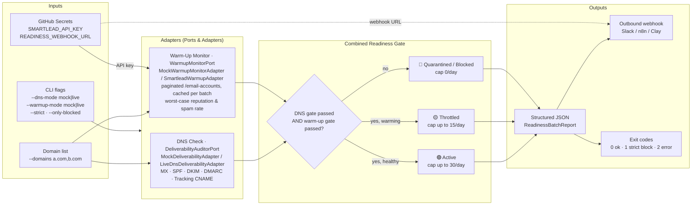
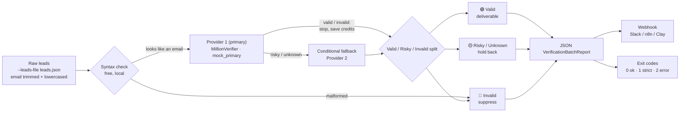

# GTM Systems Engine

Pre-flight readiness gate for cold-email sending domains. For every domain it checks **DNS authentication** and **mailbox warm-up health**, then decides whether the domain may send today and at what daily cap.



## How it decides

| Area | Rule | Result |
|---|---|---|
| **DNS: MX** | At least one MX record | Missing → `missing_mx` |
| **DNS: SPF** | Exactly one `v=spf1` record with a qualifier or `include:` | Missing, duplicated or invalid → `invalid_or_missing_spf` |
| **DNS: DKIM** | `<selector>._domainkey.<domain>` has a key (TXT) or CNAME | Missing → `missing_dkim_selector:<selector>` |
| **DNS: DMARC** | `_dmarc.<domain>` has a policy (`none`, `quarantine` or `reject`) | Missing → `missing_dmarc` |
| **DNS: Tracking** | Tracking host resolves (CNAME or A) | Missing → `invalid_tracking_cname:<host>` |
| **Warm-up: quarantine** | No accounts, SMTP disconnected, warm-up blocked, status ≠ `ACTIVE`, lowest reputation < 70 (Smartlead) / < 65 (mock), or worst spam/bounce rate > 3% | 🔴 cap **0**, gate fails |
| **Warm-up: throttle** | Lowest reputation < 85 or worst spam/bounce rate > 1.5% | 🟡 cap **min(daily limit, 15)**, gate passes |
| **Warm-up: active** | Everything healthy | 🟢 cap **min(daily limit, 30)**, gate passes |
| **Readiness** | Ready only if **both** gates pass; a blocked domain's cap is 0 | Reasons prefixed `dns:` / `warmup:` |

A domain's warm-up health is judged by its **weakest mailbox**: the lowest reputation and the highest spam rate across all its Smartlead accounts. Its daily limit is the sum of their `max_email_per_day`.

## Run it

| Where | How |
|---|---|
| **Install** | `pip install -e ".[dev]"` (Python 3.11+) |
| **Tests** | `pytest -v` |
| **Local, sample data** | `python -m gtm_engine.cli.check_readiness --domains healthy-outreach.com,throttled-sender.com,quarantined-sender.com` |
| **Local, live data** | `SMARTLEAD_API_KEY=… python -m gtm_engine.cli.check_readiness --domains yourdomain.com --dns-mode live --warmup-mode live --selector <dkim-selector> --tracking-host <subdomain> --strict` |
| **Send to a webhook** | Add `--webhook-url <url>` (or set `READINESS_WEBHOOK_URL`); add `--only-blocked` to post only when something is blocked |
| **GitHub Actions: CI** | Every push to `main` / `feat/**` and every PR runs `pytest` |
| **GitHub Actions: daily** | Runs the readiness check at 20:00 UTC (mock data by default) |
| **GitHub Actions: on demand** | Actions → *GTM Readiness CI & Runner* → *Run workflow*, then choose domains, `dns_mode`, `warmup_mode`, selector and tracking host |
| **Secrets** | Settings → Secrets and variables → Actions: `SMARTLEAD_API_KEY`, `READINESS_WEBHOOK_URL` |

**Exit codes:** `0` the run completed · `1` `--strict` and at least one domain is blocked · `2` an error (Smartlead API or webhook failure; the key is never printed).

## Day 2: Lead verification waterfall

Verifies lead emails before they enter a sequence. Clear answers stop at the first provider; only unsure results pay for a second opinion.



| Area | Rule |
|---|---|
| **Syntax check** | Not shaped like `name@domain.tld` → `invalid` with `attempts: 0`; no provider is called |
| **Stop rule** | `valid` or `invalid` from any provider ends the waterfall |
| **Fallback rule** | `risky` or `unknown` escalates to the next provider; a provider error counts as `unknown` |
| **Tie-break** | A later `unknown` never overrides an earlier `risky` |
| **MillionVerifier mapping** | `ok` → valid · `catch_all`, `unknown` → risky · `invalid`, `disposable` → invalid · anything else → unknown |
| **Deliverable** | `true` only when the final status is `valid` |
| **Duplicates** | The same email appears once per lead in `results`, but is verified only once per batch |
| **Strict mode** | `--strict` exits `1` if any lead is risky, invalid or unknown |

| Run | Command |
|---|---|
| **Sample data** | `python -m gtm_engine.cli.verify_leads --leads-file fixtures/sample_leads.json` |
| **Live (MillionVerifier)** | `VERIFIER_API_KEY=… python -m gtm_engine.cli.verify_leads --leads-file leads.json --mode live --strict` |
| **Send to a webhook** | Add `--webhook-url <url>` (or set `VERIFICATION_WEBHOOK_URL`) |

Leads file format: a JSON list of objects with `email` (required) and optional `first_name`, `last_name`, `company_domain`.

## Layout

```text
src/gtm_engine/
  contracts/   Pydantic JSON contracts (deliverability, warmup, readiness, leads)
  ports/       Protocol interfaces the core depends on
  adapters/    Vendor/data-source implementations (DNS, warm-up, email verification, webhook)
  cli/         audit_domains, evaluate_warmup, check_readiness, verify_leads
fixtures/      Sample DNS, warm-up and lead data for mock mode
tests/         pytest suite (all network calls mocked)
```

Other commands: `python -m gtm_engine.cli.audit_domains` (DNS gate only) and `python -m gtm_engine.cli.evaluate_warmup` (warm-up gate only, mock data).
